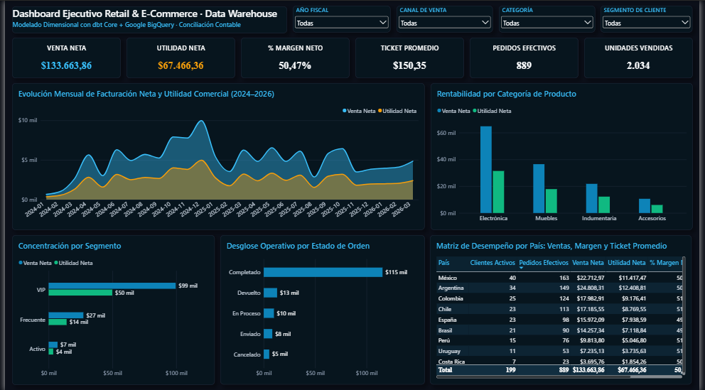
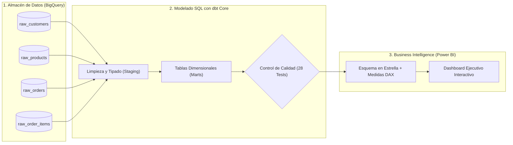
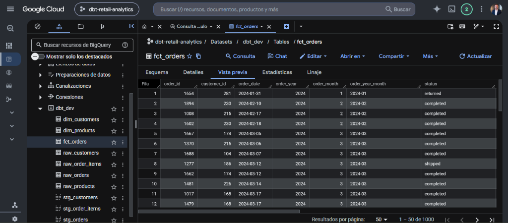
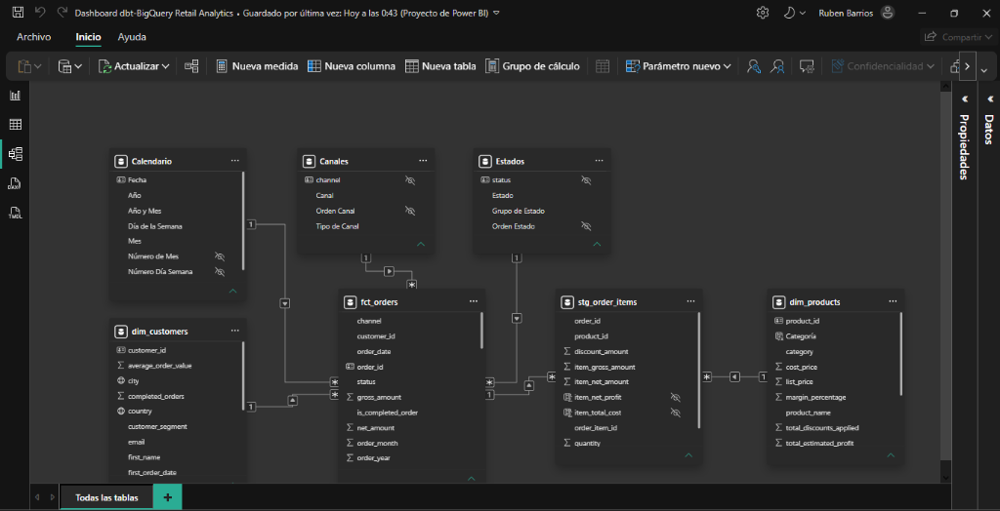

# Retail Analytics End-to-End: Modelado con dbt + Google BigQuery y Dashboard Ejecutivo en Power BI (DAX · PBIP)

[](https://www.getdbt.com/)
[](https://cloud.google.com/bigquery)
[](https://app.powerbi.com/view?r=eyJrIjoiZDdhMGMyMzktNmEyMC00Yzg0LWE1MWItZWVlY2U1YWUwMWNjIiwidCI6IjgxY2NjYzQzLWI1NjEtNDFmNy05NDgwLWU5ZThmMDI3YzQ0MyIsImMiOjR9)
[](#control-de-versiones-en-power-bi-pbip--gitgithub)
[](docs/ANALISIS_EJECUTIVO_Y_MEDIDAS_DAX.md)
[](https://docs.getdbt.com/docs/build/data-tests)
[](docs/INFORME_EJECUTIVO_END_TO_END_RETAIL_ANALYTICS.pdf)
[](#contexto-del-proyecto-y-rol-del-analista)



> 🌐 **Explora el Dashboard Interactivo en Vivo (Acceso Público):** [Abrir Dashboard en Power BI Web](https://app.powerbi.com/view?r=eyJrIjoiZDdhMGMyMzktNmEyMC00Yzg0LWE1MWItZWVlY2U1YWUwMWNjIiwidCI6IjgxY2NjYzQzLWI1NjEtNDFmNy05NDgwLWU5ZThmMDI3YzQ0MyIsImMiOjR9)  
> 📄 **Informe Completo del Proyecto End-to-End (PDF):** [Descargar / Ver `INFORME_EJECUTIVO_END_TO_END_RETAIL_ANALYTICS.pdf`](docs/INFORME_EJECUTIVO_END_TO_END_RETAIL_ANALYTICS.pdf)

---

## 📌 Contexto del Proyecto y Rol del Analista

En las empresas de comercio minorista (*Retail & E-commerce*), los datos de ventas, clientes y productos suelen llegar a la base de datos con formatos desordenados, valores nulos, fechas en texto y sin las métricas estandarizadas que la gerencia necesita para tomar decisiones.

Como **Analista de Datos**, construí una solución analítica integral de punta a punta combinando **dbt Core**, **Google BigQuery** y **Power BI**:
1. **Limpieza y estandarización SQL en la nube:** Transformación de datos crudos directamente en **Google BigQuery** mediante **dbt Core** (`Staging` $\rightarrow$ `Marts`).
2. **Aseguramiento de calidad de datos:** Ejecución de **28 pruebas automáticas (`dbt test`)** para garantizar cero duplicados, cero nulos críticos e integridad referencial antes de conectar la capa de visualización.
3. **Modelado en Estrella, DAX y Visualización Ejecutiva:** Conexión directa de **Power BI** a BigQuery, construyendo dimensiones calculadas y un catálogo de medidas **DAX** enfocado en rentabilidad comercial, segmentación de clientes y desempeño operativo.

---

## 🎯 Preguntas de Negocio que responde este Proyecto

* **Rendimiento Financiero:** ¿Cuál es la Venta Neta efectiva, la Utilidad Neta real tras costos y el Margen Comercial mensual?
* **Concentración de Clientes:** ¿Cuánto representan los clientes más valiosos (*VIP*) frente a los segmentos *Frecuente* y *Activo*?
* **Rentabilidad de Catálogo:** ¿Qué categorías (*Electrónica*, *Muebles*, *Indumentaria*, *Accesorios*) lideran la facturación y ganancia neta?
* **Salud Operativa y Mercados:** ¿Qué proporción de pedidos se completa con éxito frente a devoluciones y cancelaciones, y qué países lideran las ventas regionales?

---

## 🔄 Flujo de Trabajo End-to-End del Analista



---

## 📊 Arquitectura en Google BigQuery y Modelo Semántico en Power BI

En la segunda fase del proyecto se desarrolló un informe ejecutivo en formato de control de versiones **Power BI Project (`.pbip` / `TMDL`)**, disponible en la carpeta [`powerbi/`](powerbi/), conectado directamente al dataset `dbt_dev` modelado con **dbt Core** en **Google BigQuery**:

### 1. Tablas Analíticas y Vista Previa en Google BigQuery (`dbt_dev`)


### 2. Modelo Semántico en Estrella en Power BI Desktop (`PBIP`)
Las tablas limpias de BigQuery (`fct_orders`, `stg_order_items`, `dim_customers`, `dim_products`) se integran con dimensiones calculadas en **DAX** (`Calendario`, `Canales`, `Estados`) mediante relaciones unidireccionales (`1:*`) para garantizar integridad analítica e inteligencia de tiempo:



### Indicadores Clave Consolidados (DAX)
| KPI Ejecutivo | Valor Consolidado | Detalle Analítico |
| :--- | :---: | :--- |
| **Venta Neta** | `$133,663.86` | Ingresos netos de pedidos efectivos (*Completados*, *En Proceso* y *Enviados*). |
| **Utilidad Neta** | `$67,466.36` | Ganancia comercial neta descontando promociones y costo unitario (`COGS`). |
| **% Margen Neto** | `50.47%` | Rentabilidad sostenida por encima del `50%` en los 9 mercados. |
| **Ticket Promedio** | `$150.35` | Valor medio por orden efectiva (`AOV`). |
| **Pedidos Efectivos** | `889` | `88.9%` de conversión efectiva sobre `1,000` órdenes totales. |
| **Unidades Vendidas** | `2,034` | Volumen físico despachado (`~2.29` unidades promedio por pedido). |

### Principales Insights del Análisis
* **Liderazgo por Categoría:** **Electrónica** (`~$65 mil` ventas | `~$32 mil` utilidad) y **Muebles** (`~$37 mil` ventas | `~$18 mil` utilidad) concentran más del `75%` de la rentabilidad del catálogo.
* **Concentración por Segmento:** El segmento **VIP** (`97` clientes) genera **`$99,481.20`** (`74.4%` de las ventas netas) con un ticket promedio de `$182.53`, seguido por **Frecuente** (`~$27 mil`) y **Activo** (`~$7 mil`).
* **Control Operativo:** Frente a los pedidos efectivos (*Completado* `~$115 mil`, *En Proceso* `~$10 mil` y *Enviado* `~$8 mil`), se cuantifican **`~$13 mil` en Devoluciones (`7.4%`)** y **`~$5 mil` en Cancelaciones (`3.7%`)**, identificando el principal foco de mejora post-venta.
* **Desempeño por País:** **México** lidera en cantidad de pedidos efectivos (`163`) y clientes activos (`40`), mientras que **Argentina** lidera en facturación neta (`$24,808.31`) y utilidad (`$12,408.81`), seguidos por **Colombia** y **Chile**.

👉 **[Ver el Análisis Ejecutivo Completo, Diagrama Estrella y Catálogo de Fórmulas DAX aquí (`docs/ANALISIS_EJECUTIVO_Y_MEDIDAS_DAX.md`)](docs/ANALISIS_EJECUTIVO_Y_MEDIDAS_DAX.md)**  
📄 **[Descargar el Informe Completo End-to-End en PDF (`docs/INFORME_EJECUTIVO_END_TO_END_RETAIL_ANALYTICS.pdf`)](docs/INFORME_EJECUTIVO_END_TO_END_RETAIL_ANALYTICS.pdf)**

---

## 🗂️ Control de Versiones en Power BI: PBIP + Git/GitHub

En lugar de almacenar el reporte en un archivo binario cerrado (`.pbix`), se trabajó con buenas prácticas modernas de control de versiones para analítica y Business Intelligence:

* **1. Formato `PBIP` (`TMDL` + `PBIR`):** Proyecto guardado como **Power BI Project (`.pbip`)**, desacoplando el **Modelo Semántico** en código legible `TMDL` (`model.tmdl`, `relationships.tmdl`, `tables/*.tmdl` con las medidas `DAX`) y la **definición visual del reporte** en archivos estructurados JSON junto al tema personalizado `Retail_Executive_Dark.json`.
* **2. Versionado con `Git` y `GitHub`:** Gestión unificada en un mismo repositorio de las transformaciones SQL de **dbt Core** y del modelo/reporte de **Power BI**, configurando [`.gitignore`](.gitignore) para excluir cachés pesadas locales (`cache.abf`, `localSettings.json`) y credenciales sensibles de Google Cloud.
* **3. Publicación en `Power BI Service`:** Despliegue del informe interactivo en la web de Power BI para acceso y exploración ejecutiva en vivo.

---

## 📂 Estructura del Repositorio

* [`models/staging/`](models/staging/): Vistas SQL de limpieza, estandarización de tipos de datos y deduplicación en BigQuery (`stg_customers`, `stg_products`, `stg_orders`, `stg_order_items`).
* [`models/marts/`](models/marts/): Tablas analíticas dimensionales y de hechos (`fct_orders`, `dim_customers`, `dim_products`) junto a sus pruebas de calidad en [`schema.yml`](models/marts/schema.yml).
* [`analyses/`](analyses/): Consultas SQL de perfilado estadístico y exploración analítica (`profile_dim_customers.sql`).
* [`seeds/`](seeds/) y [`data/`](data/): Dataset simulado reproducible (*Retail & E-commerce Mock Data*, libre de PII con dominios `@example.com`).
* [`powerbi/`](powerbi/): Proyecto completo de Power BI en formato versionable (`.pbip`), incluyendo el **Modelo Semántico en `TMDL`** (tablas, relaciones y medidas DAX) y la definición visual del reporte con tema personalizado oscuro (`Retail_Executive_Dark.json`).
* [`docs/`](docs/): Documentación ejecutiva ([`ANALISIS_EJECUTIVO_Y_MEDIDAS_DAX.md`](docs/ANALISIS_EJECUTIVO_Y_MEDIDAS_DAX.md)) e **Informe Completo End-to-End en PDF** ([`INFORME_EJECUTIVO_END_TO_END_RETAIL_ANALYTICS.pdf`](docs/INFORME_EJECUTIVO_END_TO_END_RETAIL_ANALYTICS.pdf)).
* [`assets/`](assets/): Capturas del Dashboard Ejecutivo, de la vista del Modelo en Estrella en Power BI y de la vista previa de tablas en Google BigQuery.

---

## 🗄️ Tablas Analíticas Modeladas en dbt (`dbt_dev`)

1. **`fct_orders` (Tabla de Hechos de Órdenes):** Consolida a nivel de pedido las unidades, monto bruto (`gross_amount`), descuentos (`total_discount_amount`), venta neta (`net_amount`), canal, estado e indicador de orden efectiva (`is_completed_order`).
2. **`dim_customers` (Dimensión 360 del Cliente):** Historial de primera y última compra, órdenes acumuladas, **Customer Lifetime Value (`lifetime_spend`)**, **Ticket Promedio (`average_order_value`)** y segmentación comercial (*VIP*, *Frequent*, *Active*).
3. **`dim_products` (Catálogo y Rentabilidad Comercial):** Precios de costo y lista, margen unitario, unidades efectivas vendidas, ingresos netos acumulados y ganancia estimada por producto.

---

## 🛡️ Control de Calidad Automatizado (`dbt test`)

Se ejecutan **28 pruebas automáticas** en BigQuery para blindar la integridad de los reportes:
* **Unicidad (`unique`):** Garantiza cero duplicados en claves primarias de clientes, productos y órdenes.
* **Completitud (`not_null`):** Verifica que importes, fechas e identificadores críticos nunca estén vacíos.
* **Integridad Referencial (`relationships`):** Comprueba que todo cliente y producto transaccionado exista en sus respectivas dimensiones maestras.
* **Reglas de Dominio (`accepted_values`):** Valida estados operativos (`completed`, `shipped`, `processing`, `returned`, `cancelled`) y segmentos comerciales válidos.

---

## 🚀 Cómo Reproducir este Proyecto Localmente

1. **Clonar este repositorio:**
   ```bash
   git clone https://github.com/rubenbarrios-bigdata/retail-analytics-dbt.git
   cd retail-analytics-dbt
   ```

2. **Crear y activar entorno virtual en Windows:**
   ```powershell
   python -m venv .venv
   .venv\Scripts\activate
   pip install dbt-core dbt-bigquery
   ```

3. **Configurar credenciales de Google BigQuery:**
   Configurar `profiles.yml` en `~/.dbt/` apuntando a tu proyecto de Google Cloud.

4. **Ejecutar el flujo dbt en BigQuery:**
   ```powershell
   dbt debug
   dbt seed
   dbt run
   dbt test
   ```

5. **Abrir el proyecto de Power BI:**
   Abrir [`powerbi/Dashboard dbt-BigQuery Retail Analytics.pbip`](powerbi/) en **Power BI Desktop** para explorar el Modelo en Estrella, el catálogo DAX y el Dashboard conectado a BigQuery.

---

## 👨‍💻 Autor

**Rubén Barrios**  
*Analista de Datos | Business Intelligence (SQL · dbt · Google BigQuery · Power BI · DAX · PBIP · Git/GitHub)*
