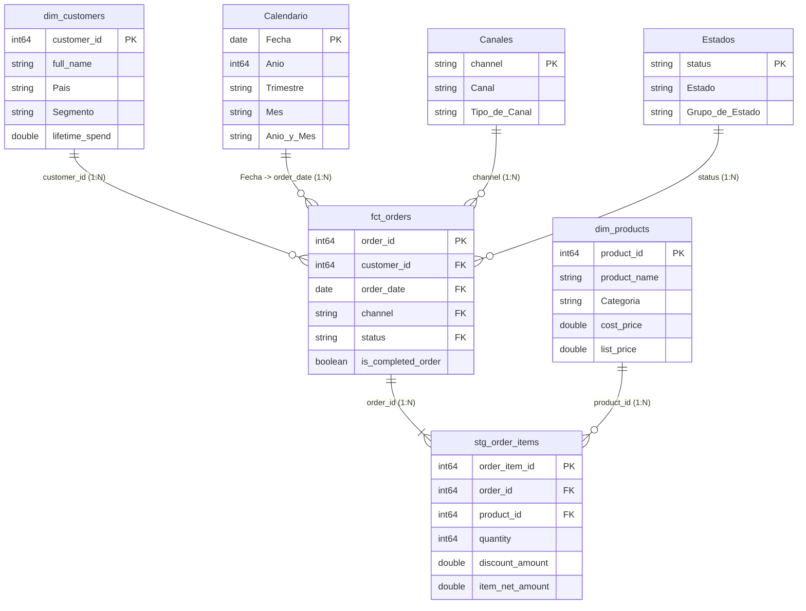

# Análisis Ejecutivo de Negocio, Modelo en Estrella y Catálogo DAX (Power BI + BigQuery)

Este documento detalla la segunda etapa del proyecto **Retail Analytics**: la conexión de **Power BI** al almacén de datos en **Google BigQuery** (`dbt-retail-analytics.dbt_dev`), el diseño del **Modelo Semántico en Estrella**, el desarrollo de medidas **DAX** y los hallazgos estratégicos obtenidos del Dashboard Ejecutivo.


> 🔗 **Enlace en Power BI Service:** [Ver Dashboard Ejecutivo en Power BI Service](https://app.powerbi.com/groups/me/reports/e711ecc6-2b4d-444a-9065-9f9e82b8cc5f/dc6e54048909792c2769?experience=power-bi)

---

## 1. Arquitectura del Modelo Semántico en Estrella (Power BI)

El modelo semántico consume mediante el conector nativo de **Google BigQuery** las tablas limpias y validadas por **dbt Core**, complementándolas con dimensiones analíticas calculadas en **DAX** para garantizar el filtrado unidireccional (`1:N`) y la inteligencia temporal continua:



### Estandarización Semántica para el Usuario Final
Para garantizar una experiencia ejecutiva limpia y 100% en español:
* **Categorías de Producto (`dim_products[Categoría]`):** Estandarizadas a *Electrónica*, *Muebles*, *Indumentaria* y *Accesorios*.
* **Segmentos de Cliente (`dim_customers[Segmento]`):** Clasificación comercial jerárquica (*VIP*, *Frecuente*, *Activo*) ordenada mediante columna auxiliar (`SortByColumn`).
* **Canales y Estados (`Canales` y `Estados`):** Traducción amigable (*Web*, *App Móvil*, *Tienda Física* y *Completado*, *Enviado*, *En Proceso*, *Devuelto*, *Cancelado*).

---

## 2. Catálogo de Medidas DAX Desarrolladas

Todas las medidas de negocio se encuentran centralizadas en `fct_orders`, organizadas en carpetas de visualización (*Display Folders*):

### 📁 `01 KPIs Principales` (Criterio Comercial Efectivo)
Contabiliza los pedidos comercialmente activos (`completed`, `processing`, `shipped`), excluyendo devoluciones y cancelaciones:

```dax
Venta Neta =
CALCULATE(
    SUM(stg_order_items[item_net_amount]),
    KEEPFILTERS(fct_orders[status] IN {"completed", "processing", "shipped"})
)

Costo de Ventas =
CALCULATE(
    SUM(stg_order_items[item_total_cost]),
    KEEPFILTERS(fct_orders[status] IN {"completed", "processing", "shipped"})
)

Utilidad Neta = [Venta Neta] - [Costo de Ventas]

% Margen Neto = DIVIDE([Utilidad Neta], [Venta Neta], BLANK())

Pedidos Efectivos =
CALCULATE(
    DISTINCTCOUNT(stg_order_items[order_id]),
    KEEPFILTERS(fct_orders[status] IN {"completed", "processing", "shipped"})
)

Ticket Promedio = DIVIDE([Venta Neta], [Pedidos Efectivos], BLANK())

Unidades Vendidas =
CALCULATE(
    SUM(stg_order_items[quantity]),
    KEEPFILTERS(fct_orders[status] IN {"completed", "processing", "shipped"})
)
```

### 📁 `02 Control Operativo y Descuentos`
Permite auditar el volumen global registrado y cuantificar la fricción comercial por devoluciones y cancelaciones:

```dax
Venta Global Registrada = SUM(stg_order_items[item_net_amount])

Descuentos Otorgados =
CALCULATE(
    SUM(stg_order_items[discount_amount]),
    KEEPFILTERS(fct_orders[status] IN {"completed", "processing", "shipped"})
)

% Tasa de Descuento = DIVIDE([Descuentos Otorgados], [Ingreso Bruto], BLANK())

Importe Devoluciones =
CALCULATE(
    SUM(stg_order_items[item_net_amount]),
    KEEPFILTERS(fct_orders[status] = "returned")
)

% Tasa de Devolución = DIVIDE([Pedidos Devueltos], [Pedidos Totales], 0)

% Tasa de Cancelación = DIVIDE([Pedidos Cancelados], [Pedidos Totales], 0)
```

### 📁 `03 Clientes y Segmentación` & `04 Inteligencia Temporal`
```dax
Clientes Activos =
CALCULATE(
    DISTINCTCOUNT(fct_orders[customer_id]),
    CROSSFILTER(stg_order_items[order_id], fct_orders[order_id], Both),
    KEEPFILTERS(fct_orders[status] IN {"completed", "processing", "shipped"})
)

LTV Promedio = DIVIDE([Venta Neta], [Clientes Activos], BLANK())

Venta Mes Anterior = CALCULATE([Venta Neta], DATEADD(Calendario[Fecha], -1, MONTH))

% Crecimiento MoM = DIVIDE([Venta Neta] - [Venta Mes Anterior], [Venta Mes Anterior], BLANK())

Venta YTD = TOTALYTD([Venta Neta], Calendario[Fecha])
```

---

## 3. Análisis Ejecutivo de Resultados e Insights Clave

### 📊 Resumen de Indicadores Globales
| Indicador (KPI) | Resultado Consolidado | Interpretación de Negocio |
| :--- | :---: | :--- |
| **Venta Neta** | `$133,663.86` | Facturación efectiva neta tras descuentos promocionales. |
| **Utilidad Neta** | `$67,466.36` | Ganancia real tras descontar el costo directo del producto (`COGS`). |
| **% Margen Neto** | `50.47%` | Rentabilidad comercial sólida y estable por encima del umbral del `50%`. |
| **Ticket Promedio (AOV)** | `$150.35` | Gasto neto promedio por cada orden de compra efectiva. |
| **Pedidos Efectivos** | `889` | `88.9%` de efectividad sobre las `1,000` órdenes totales registradas. |
| **Unidades Vendidas** | `2,034` | Promedio saludable de `~2.29` unidades por pedido efectivo. |

### 🔍 Hallazgos por Dimensión de Análisis

1. **Evolución Mensual de Facturación y Utilidad (2024–2026):**
   * Se evidencia una fuerte tracción durante el cuarto trimestre de 2024 (**pico máximo en diciembre de 2024 rozando los `$10,000` mensuales** por estacionalidad de fin de año).
   * La curva de **Utilidad Neta** (línea ámbar) acompaña de forma paralela a la **Venta Neta** (línea azul), confirmando que el crecimiento en volumen no sacrificó la rentabilidad unitaria ni dependió de descuentos agresivos.

2. **Rentabilidad por Categoría de Producto:**
   * **Electrónica** (`~$65 mil` en ventas | `~$32 mil` en utilidad) y **Muebles** (`~$37 mil` en ventas | `~$18 mil` en utilidad) representan los motores financieros del negocio, concentrando más del **75% de la ganancia total**.
   * **Indumentaria** y **Accesorios** actúan como categorías complementarias de rotación e incremento de unidades por ticket (*cross-selling*).

3. **Concentración por Segmento de Cliente (Efecto Pareto):**
   * El segmento **VIP** (`97` clientes con gasto acumulado $\ge$ `$600`) genera **`$99,481.20` en Venta Neta (`74.4%` del total)** y **`$49,809.70` en Utilidad Neta**, con un ticket promedio superior (`$182.53`).
   * Los segmentos **Frecuente** (`~$27 mil`) y **Activo** (`~$7 mil`) representan la principal cantera de fidelización para escalar el valor de vida del cliente (*LTV*).

4. **Desglose Operativo por Estado de Orden:**
   * Las ventas efectivas se distribuyen en órdenes **Completadas (`~$115 mil`)**, **En Proceso (`~$10 mil`)** y **Enviadas (`~$8 mil`)**.
   * La fricción comercial se concentra principalmente en **Devoluciones (`~$13 mil`, `7.4%` de los pedidos)** frente a **Cancelaciones (`~$5 mil`, `3.7%` de los pedidos)**, señalando a la logística inversa/post-venta como el foco prioritario de optimización.

5. **Desempeño Geográfico por País (9 Mercados):**
   * **México** lidera en volumen operativo (`40` clientes activos y `163` pedidos efectivos por `$22,712.97`), mientras que **Argentina** lidera en facturación y ganancia total (`149` pedidos por **`$24,808.31`** de Venta Neta y **`$12,408.81`** de Utilidad Neta), seguidos por **Colombia** (`124` pedidos, `$17,982.91`) y **Chile** (`113` pedidos, `$17,185.55`).
   * El **% Margen Neto se mantiene homogéneo entre `49.7%` y `51.5%`** en los 9 países, demostrando una política de precios consistente a nivel regional.

---

## 4. Recomendaciones Estratégicas Accionables

1. **Programa de Retención VIP:** Dado que el segmento *VIP* aporta casi tres cuartas partes de la utilidad neta, implementar beneficios exclusivos (envío prioritario o acceso anticipado en *Electrónica* y *Muebles*) protege el núcleo de ingresos de la compañía.
2. **Desarrollo del Segmento Frecuente a VIP:** Diseñar campañas de *upselling* y *bundles* (combinando *Electrónica* con *Accesorios*) dirigidas a clientes *Frecuentes* para superar el umbral de `$600` de gasto acumulado.
3. **Auditoría de Devoluciones (`~$13 mil`):** Analizar las causas de devolución por SKU y canal de venta para reducir la tasa actual del `7.4%` al menos en 2 puntos porcentuales, recuperando margen directo sin costo adicional de adquisición de clientes.

